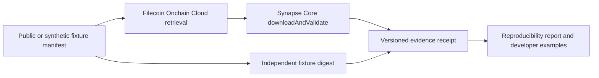

# BalanX Filecoin Retrieval Evidence Kit

## Applicant and scope

- Individual or Entity Name: BALANX LLC, Michigan, United States (original formation July 17, 2025).
- Category: Developer and Data Tooling.
- Proposed request: US$12,000.
- Team: Abe Shukeir, Co-Founder & CEO; Douglas Li, Co-Founder & COO.
- Contact: contact@balanxbio.com.
- Proposer GitHub account: [abeshukeir](https://github.com/abeshukeir).
- Website: https://www.balanxbio.com/
- Company LinkedIn: https://www.linkedin.com/company/balanxbio/
- Project repository: https://github.com/abeshukeir/balanx-filecoin-retrieval-evidence-kit
- The repository will initially contain proposal/planning documents only. No existing BalanX repository or proprietary source is offered; funded implementation will begin only after a signed grant agreement.

## Project summary

AI and research applications need an inspectable connection between a named dataset and the bytes they actually used. A successful download alone does not provide a reproducible record of the dataset reference, validation result, software version and failure conditions. We propose a small, open-source evidence kit that makes those details explicit for Filecoin-backed data workflows.

The kit would build on the official Filecoin Onchain Cloud Synapse SDK and the documented Synapse Core `Piece.downloadAndValidate` retrieval/validation API. It would add a versioned evidence-record format, reproducible public/synthetic fixtures, a failure-scenario runner and concise integration examples. PieceCID, SDK validation results and an independent fixture digest would remain separate fields; a file digest would never be presented as a replacement for a Filecoin storage commitment. Reports would distinguish content integrity from the factual accuracy of a dataset.

BalanX's existing AI software and connected technology are fully built and currently in testing. The Filecoin-specific kit proposed here is separate new work. Funding would cover only its new adapter, fixtures, evidence records and documentation. Existing BalanX products, models, source, customer data and unrelated chain-specific projects are outside the grant scope and budget.

## Ecosystem value

The intended users are developers connecting Filecoin data to AI evaluation, research-data retrieval and evidence-linked applications. A common, machine-readable receipt would help them compare runs, reproduce faults and identify whether a failure arose during retrieval, content checking or manifest handling. Three documented workflow examples would make the kit usable beyond BalanX.

The work would target Filecoin Onchain Cloud retrieval directly. It would reuse the ecosystem's supported validation primitives and add an application-facing evidence layer rather than another storage protocol. No current Filecoin deployment, customer, sponsor or measured performance result is claimed.

## Deliverables and acceptance targets

1. A versioned JSON evidence schema recording the requested PieceCID, manifest reference, provider/endpoint reference when available, supported SDK version, timing, integrity outcomes and a typed error result. Records would exclude application prompts, personal information and secrets.
2. A retrieval adapter and command-line runner using a supported, pinned Synapse SDK release. The runner would produce deterministic records for fixed fixtures and simulated conditions.
3. At least 120 documented test scenarios covering supported retrieval paths, changed/truncated payloads, timeouts, unavailable data and malformed manifests. These are proposed acceptance targets, not completed results. The scope does not include a new publisher-signature or identity protocol.
4. A reproducibility report with environment and dependency pins, three end-to-end examples, CI instructions and a maintainer guide. Timing results would describe the tested environment and would not be represented as network-wide performance.

## Proposed evidence flow

PieceCID validation and the independent fixture digest are recorded separately.

## Data and adoption plan

The project makes no customer-data onboarding commitment. The initial corpus would contain at most 1 GiB of public or synthetic fixtures. Its purpose is developer reliability and evidence handling, rather than a storage-volume campaign.

Adoption work would consist of public documentation, three reproducible examples and a release announcement through the project's approved channels. We would seek feedback from Filecoin developers and report actual responses. No external users, partnerships or design partners are promised as an existing result or guaranteed milestone.

## Proposed milestones and budget

The schedule below assumes an agreement effective by February 1, 2027. If approval occurs later, the same eight-week sequence would be re-dated in the agreement. No funded work would start before both parties sign.

| Milestone | Target date | Deliverables | Staffing and roles | Proposed funding |
| --- | --- | --- | --- | ---: |
| 1 — Specification and fixtures | February 15, 2027 | Evidence schema, supported retrieval boundary, fixture manifest and acceptance plan | Abe: technical specification and acceptance criteria; Douglas: fixture workflow and documentation plan | $2,000 |
| 2 — Retrieval runner | March 1, 2027 | Synapse-based adapter, typed failures and first reproducible example | Douglas: adapter and example; Abe: validation boundary and review | $4,000 |
| 3 — Failure and reproducibility suite | March 15, 2027 | At least 120 proposed scenarios, CI configuration and reproducibility report | Abe: failure suite and reproducibility; Douglas: CI integration and report | $4,000 |
| 4 — Release and handoff | March 29, 2027 | Three examples, documentation, maintainer guide and public release package | Douglas: release and maintainer guide; Abe: compatibility and acceptance review | $2,000 |
| **Total** | | | | **$12,000** |

The request covers engineering, testing and documentation for these deliverables. It excludes production infrastructure, token purchases, existing products and work proposed to other grant programmes. Payment, travel, hiring and future contract terms are not accepted through this draft.

## Team and maintenance

Abe Shukeir would lead the technical scope, evidence schema and acceptance review. Douglas Li would lead developer workflow, integration documentation and release coordination; both founders can implement the product end to end. Both are full-time BalanX founders with four years of full-time professional experience each. They met in person at university, have known one another for six years and began developing BalanX in early 2025.

- Abe: https://www.linkedin.com/in/abe-shukeir-balanx/
- Douglas: https://www.linkedin.com/in/douglas-li-b9a885253/

BalanX participates in NVIDIA Inception, AWS Activate and the Neo4j Startup Program. These are programme memberships, not Filecoin sponsorship or evidence of a grant award.

The proposed grant-funded maintenance period is three months after the final release, limited to triaging reported defects, documenting compatibility and publishing reproducible fixes within this kit. Longer support would require a separate, explicit plan; no ongoing proprietary-product support is offered through the grant.

## Team code repositories

This is a new project. The dedicated project repository linked above will initially contain proposal and planning documents only. Grant-funded code will be developed there after a signed agreement. No existing BalanX source repository is offered or incorporated into this grant request.

## Licensing and agreement boundary

Yes: all work funded under this narrowly defined project will be published under the required MIT and Apache-2.0 dual licence. This scope does not include existing BalanX technology or unrelated work. Grant-funded implementation will begin only after both parties sign the grant agreement. This application accepts no grant agreement or payment terms.

## Discovery and next steps

We found the programme through the Filecoin Foundation's official grants page. Use contact@balanxbio.com for application and agreement correspondence. No Filecoin/IPFS technical sponsor is claimed in this proposal.

## Technical and programme sources

- https://fil.org/grants
- https://github.com/filecoin-project/devgrants/blob/master/Program%20Resources/Open%20Grants%20README.md
- https://github.com/filecoin-project/devgrants/blob/master/.github/ISSUE_TEMPLATE/open-grant-appolication.md
- https://docs.filecoin.cloud/developer-guides/synapse/
- https://docs.filecoin.cloud/developer-guides/storage/storage-operations/
- https://docs.filecoin.cloud/reference/filoz/synapse-core/piece/functions/downloadandvalidate/
